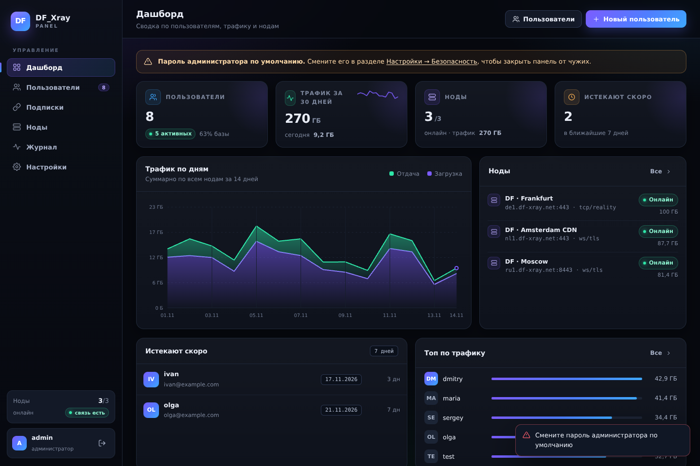
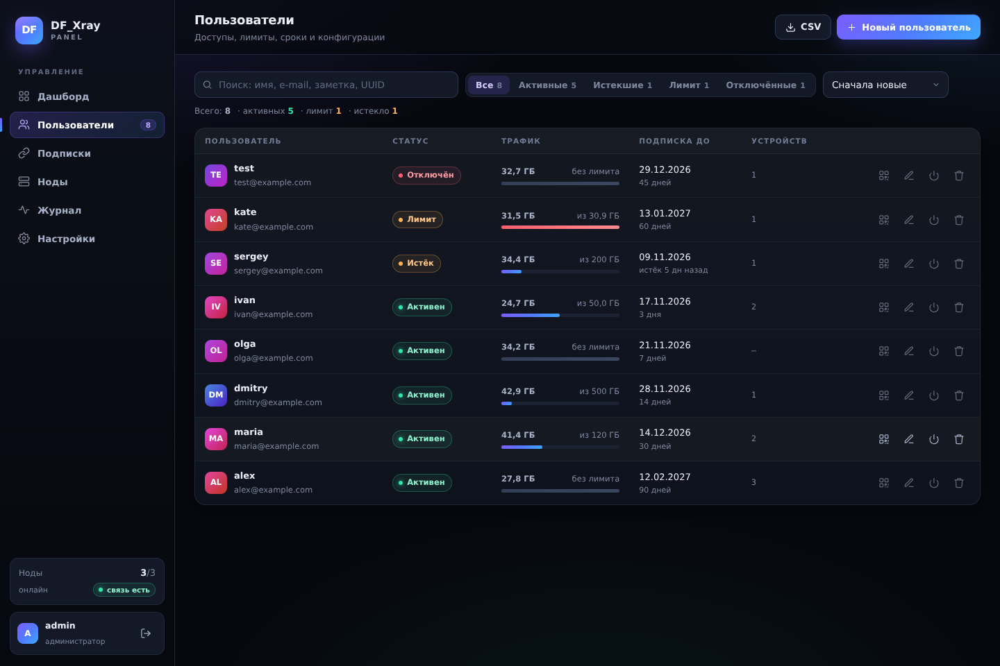
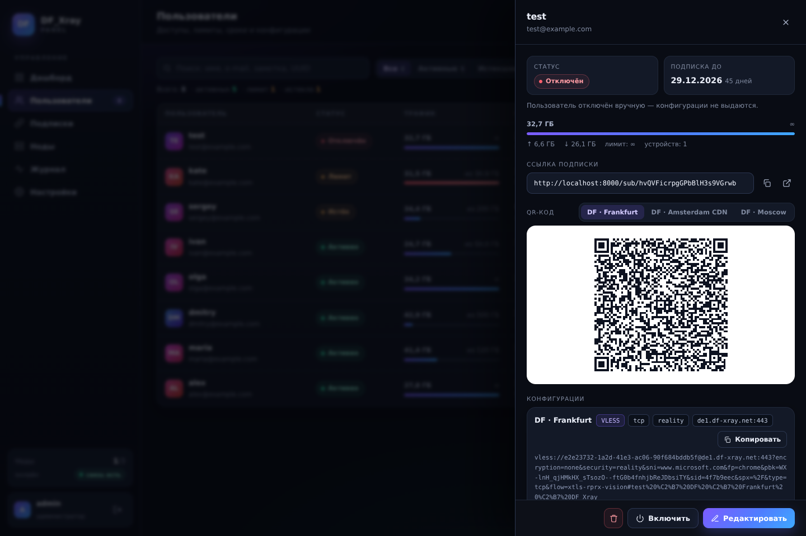
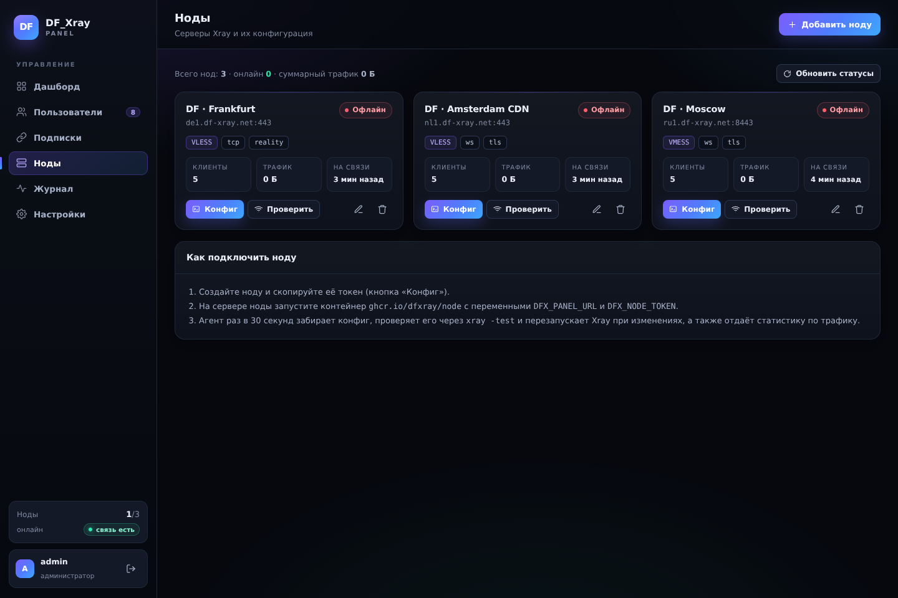
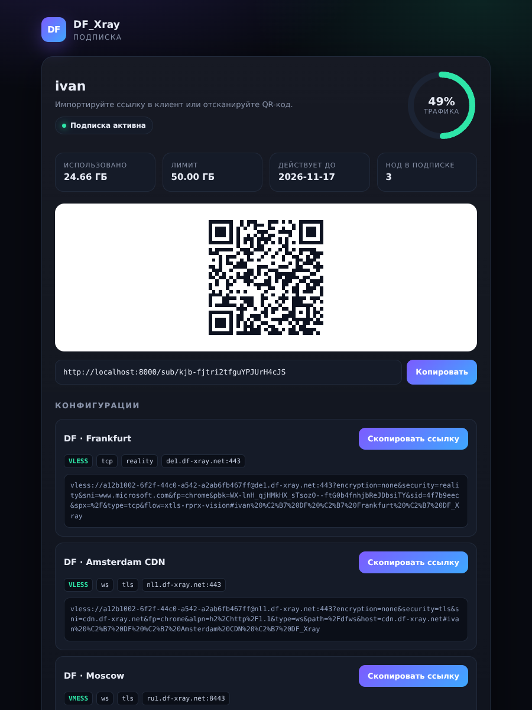

# DF_Xray Panel

Лёгкая панель управления [Xray-core](https://github.com/XTLS/Xray-core) в стиле **DF**: тёмный интерфейс,
подписки, QR-коды, лимиты трафика и срока, мульти-ноды и Docker Compose — без единой внешней
Python-зависимости.

> Один сервер → SQLite → ноды Xray по pull-модели. Захотите ещё ноду — добавляете её в панели
> и поднимаете контейнер с токеном, конфиг прилетит сам.

[](LICENSE)
[](https://www.python.org/)


---

## Содержание

- [Возможности](#возможности)
- [Скриншоты](#скриншоты)
- [Быстрый старт](#быстрый-старт)
- [Первая настройка](#первая-настройка)
- [Как подключить ноду](#как-подключить-ноду)
- [Подписки и QR-коды](#подписки-и-qr-коды)
- [Лимиты и сроки](#лимиты-и-сроки)
- [Архитектура](#архитектура)
- [Настройки и переменные окружения](#настройки-и-переменные-окружения)
- [Клиентская часть API](#клиентская-часть-api)
- [Безопасность](#безопасность)
- [Бэкапы и обслуживание](#бэкапы-и-обслуживание)
- [Разработка и тесты](#разработка-и-тесты)
- [Структура проекта](#структура-проекта)
- [Дорожная карта](#дорожная-карта)
- [Лицензия](#лицензия)

## Возможности

**Пользователи и доступы**
- CRUD пользователей, UUID, flow `xtls-rprx-vision`, ограничение числа устройств (`limitIp`).
- Лимит трафика и дата окончания подписки; статусы `активен / лимит / истёк / отключён`
  считаются на лету — никаких «залипших» блокировок.
- Массовые действия: продлить, сбросить трафик, перевыпустить UUID или токен подписки,
  включить/отключить, удалить.
- Поиск, фильтры по статусу, сортировка, экспорт в CSV.

**Подписки**
- Один адрес на пользователя: `/sub/<token>` — base64-список `vless:// / vmess:// / trojan://`.
- Заголовки `subscription-userinfo`, `profile-title`, `profile-update-interval`,
  `profile-web-page-url`, `support-url` — клиенты показывают расход и дату окончания.
- Публичная страница подписки `/sub/<token>/page`: тёмная витрина с QR, кольцом трафика,
  чипами протоколов и кнопками копирования.
- QR-коды генерируются на сервере (SVG и PNG) — без JS-библиотек и внешних сервисов.

**Ноды**
- Мульти-ноды: VLESS / VMess / Trojan, транспорт TCP / WebSocket / gRPC / XHTTP / HTTP2,
  безопасность Reality / TLS / без шифрования.
- Конфиг Xray генерируется на лету из данных панели: клиенты, Reality-ключи, сертификаты,
  sniffing, API статистики, правила маршрутизации (BitTorrent, реклама, приватные IP,
  российские сайты напрямую), DNS-пресеты.
- Агент ноды (`node/agent.py`) забирает конфиг по токену, проверяет `xray -test`,
  перезапускает Xray при изменениях и присылает статистику. Упавший Xray поднимается сам.
- Проверка доступности порта (TCP probe), генерация Reality-ключей (`x25519` через openssl),
  перевыпуск токена.

**Панель**
- Дашборд: сводка, график трафика за 14 дней, статусы нод, топ по трафику,
  истекающие подписки, журнал событий.
- Аутентификация: PBKDF2-SHA256 (210 000 итераций), сессии в базе, HttpOnly cookie,
  защита от перебора, CSRF-заголовок, предупреждение о пароле по умолчанию.
- Журнал действий администраторов, скачивание SQLite-бэкапа, очистка старых срезов статистики.
- Адаптивная вёрстка (десктоп → планшет → телефон), без сборщиков и node_modules.

**Инфраструктура**
- Ноль внешних Python-зависимостей: только стандартная библиотека (`http.server`, `sqlite3`, `zlib`).
- SQLite в WAL-режиме, потокобезопасные соединения, транзакции для трафика.
- Docker Compose: панель + нода, healthcheck, non-root пользователи, один том с данными.

## Скриншоты

| Дашборд | Пользователи |
| --- | --- |
|  |  |

| Карточка пользователя | Ноды |
| --- | --- |
|  |  |

| Вход | Страница подписки |
| --- | --- |
|  |  |

Скриншоты сняты с демо-данными (`python -m app seed`).

## Быстрый старт

### Установка на VPS одной командой

Свежий сервер (Ubuntu/Debian, CentOS/Fedora, Alpine), root-доступ и, желательно, домен:

```bash
curl -fsSL https://raw.githubusercontent.com/Dolov07KBR/DF_Xray/main/install.sh | sudo bash
```

Установщик поставит Docker, загрузит панель в `/opt/dfxray`, сгенерирует пароль
администратора, соберёт контейнеры и напечатает адрес, логин и пароль.

Домен и HTTPS (Caddy + Let's Encrypt) плюс нода Xray на том же сервере:

```bash
curl -fsSL https://raw.githubusercontent.com/Dolov07KBR/DF_Xray/main/install.sh \
  | sudo bash -s -- --domain panel.example.com --with-node
```

Флаги: `--with-node`, `--no-node`, `--node-port`, `--admin-password`, `--seed-demo`,
`--port`, `--dir`, `--dry-run`, `--uninstall`. Подробности — [docs/INSTALL.md](docs/INSTALL.md).
После установки доступна команда `dfxray`: `status`, `logs`, `password`, `backup`, `update`.

### Docker Compose (рекомендуется)

```bash
git clone https://github.com/Dolov07KBR/DF_Xray.git
cd DF_Xray

cp .env.example .env
# откройте .env и задайте DFX_ADMIN_PASSWORD и DFX_BASE_URL
docker compose up -d panel
```

Панель: <http://localhost:8000> (или ваш `DFX_BASE_URL`). Логин — из `.env`
(`DFX_ADMIN_USERNAME` / `DFX_ADMIN_PASSWORD`).

Демо-данные для быстрого знакомства:

```bash
docker compose exec panel python -m app seed
# или из .env: DFX_SEED_DEMO=1
```

### Локально без Docker

Нужен только Python 3.9+:

```bash
DFX_DATA_DIR=./data DFX_ADMIN_PASSWORD='сильный-пароль' python3 -m app serve
# http://localhost:8000
```

Полезные команды:

```bash
python -m app serve --port 8080     # запуск
python -m app seed                  # демо-данные
python -m app seed --empty          # только схема
python -m app check                 # состояние базы
python -m app gen-config 1 -o xray.json   # конфиг ноды #1 в файл
python -m app reset-password        # сброс пароля администратора
```

## Первая настройка

1. Войдите под администратором из `DFX_ADMIN_USERNAME` / `DFX_ADMIN_PASSWORD`.
2. **Настройки → Общие**: название панели и **публичный адрес** — он попадает в ссылки подписок
   (`https://panel.example.com`). Если панель за прокси, адрес лучше задать явно.
3. **Настройки → Безопасность**: смените пароль. Панель помнит, что пароль дефолтный,
   и показывает предупреждение, пока вы его не смените.
4. **Ноды → Добавить ноду**: создайте первую ноду и скопируйте её токен.
5. **Пользователи → Новый пользователь**: имя, срок, лимит — панель выдаст UUID,
   токен подписки, QR-код и ссылки для всех нод.

## Как подключить ноду

Панель не ходит на ноды «снаружи»: агент сам опрашивает панель, поэтому нода может жить
за NAT и без открытых портов панели.

1. В панели создайте ноду → **Конфиг** → скопируйте токен и фрагмент `docker-compose`.
2. В `.env` на сервере ноды:

```env
NODE_TOKEN=<токен из панели>
PANEL_INTERNAL_URL=http://panel:8000   # если нода рядом с панелью
```

3. Запустите ноду:

```bash
docker compose up -d node-de
docker compose logs -f node-de
```

Агент раз в 30 секунд:

- забирает `config.json` (`GET /api/agent/config`);
- проверяет его через `xray -test` и применяет только валидный конфиг;
- перезапускает Xray при изменении ревизии конфига;
- снимает счётчики `xray api statsquery -reset` и отправляет их на панель
  (`POST /api/agent/report`), панель обновляет лимиты и статусы;
- шлёт heartbeat, если трафика нет.

Ноду можно запустить и без Docker (например, рядом с системным Xray):

```bash
DFX_PANEL_URL=https://panel.example.com \
DFX_NODE_TOKEN=... \
DFX_CONFIG_PATH=/usr/local/etc/xray/config.json \
python3 node/agent.py
```

Отладка без Xray: `DFX_DRY_RUN=1` — агент напишет конфиг и проверит цикл, но не будет
запускать процесс.

## Подписки и QR-коды

| Адрес | Что отдаёт |
| --- | --- |
| `/sub/<token>` | base64-список ссылок + заголовки профиля |
| `/sub/<token>/plain` | тот же список обычным текстом |
| `/sub/<token>/info` | JSON: расход, лимит, срок, ноды |
| `/sub/<token>/page` | публичная HTML-страница с QR и конфигурациями |
| `/sub/<token>/qr.svg` / `.png` | QR-код подписки |
| `/api/users/<id>/qr.svg?node_id=N` | QR-код конкретной конфигурации (для админа) |

Формат заголовков соответствует распространённой практике (v2rayNG, NekoBox, Streisand,
Hiddify, sing-box):

```
subscription-userinfo: upload=1234; download=5678; total=0; expire=1798588799
profile-title: base64:REZfWHJheQ==
profile-update-interval: 12
profile-web-page-url: https://panel.example.com/sub/<token>/page
```

Если пользователь отключён/просрочен/исчерпал лимит, подписка отдаёт пустой список
и заголовок `x-dfxray-status`, чтобы клиент не получал «битые» конфиги.

## Лимиты и сроки

- `limit_bytes` — суммарный лимит (upload + download). `0` = без лимита.
- `expires_at` — дата окончания. Пусто = бессрочно.
- Статус вычисляется по данным, а не хранится: `active`, `limited`, `expired`, `disabled`.
- В конфиг ноды попадают только пользователи со статусом `active`; при следующем опросе
  агента «лишние» клиенты исчезают из Xray.
- Панель возвращает в ответе на отчёт список `blocked` — агент пишет их в лог.
- После продления или сброса трафика доступ возвращается автоматически.

## Архитектура

```
                        ┌──────────────────────────────┐
      браузер ────────► │  DF_Xray Panel (Python stdlib)│
      (SPA + JSON)      │  http.server · SQLite (WAL)   │
                        │  Xray config generator        │
                        └───────┬───────────────┬──────┘
                                │               │
                    /sub/<token>│               │ /api/agent/config, /report
                                │               │ (pull, по токену ноды)
                                ▼               ▼
                        ┌───────────────┐   ┌──────────────────────────────┐
                        │   Клиенты     │   │ DF_Xray Node (Alpine + Xray) │
                        │ v2rayNG, etc. │   │ agent.py ⇄ xray -test / run  │
                        └───────────────┘   │ config.json, geoip/geosite   │
                                            └──────────────────────────────┘
```

- **Панель** — один процесс, статика + API, SQLite-файл в `/data`.
- **Нода** — контейнер с Xray и агентом; конфиг тянется по HTTPS, токен один на ноду.
- **Трафик** — Xray считает байты по `email` (= username) и `statsquery`, агент отправляет
  дельты, панель пишет их в суточные срезы и суммарные счётчики.
- **Мульти-ноды** — агенты независимы; можно ограничивать пользователя списком нод.

## Настройки и переменные окружения

Панель:

| Переменная | По умолчанию | Назначение |
| --- | --- | --- |
| `DFX_DATA_DIR` | `./data` | каталог SQLite и служебных файлов |
| `DFX_HOST` / `DFX_PORT` | `0.0.0.0` / `8000` | адрес панели |
| `DFX_BASE_URL` | авто | публичный адрес для ссылок подписок |
| `DFX_ADMIN_USERNAME` | `admin` | первый администратор |
| `DFX_ADMIN_PASSWORD` | `admin` ⚠️ | пароль первого администратора |
| `DFX_SESSION_TTL_HOURS` | `168` | срок жизни сессии |
| `DFX_TRUST_PROXY` | `1` | доверять `X-Forwarded-*` |
| `DFX_SEED_DEMO` | `0` | демо-данные при первом старте |
| `DFX_NODE_OFFLINE_AFTER` | `180` | секунд без heartbeat до «офлайн» |
| `DFX_AGENT_POLL` | `30` | период опроса нод |

Нода:

| Переменная | По умолчанию | Назначение |
| --- | --- | --- |
| `DFX_PANEL_URL` | — | адрес панели (обязательно) |
| `DFX_NODE_TOKEN` | — | токен ноды из панели (обязательно) |
| `DFX_XRAY_BIN` | `/usr/local/bin/xray` | путь к бинарнику |
| `DFX_CONFIG_PATH` | `/etc/xray/config.json` | куда писать конфиг |
| `DFX_STATS_API` | `127.0.0.1:10085` | gRPC API статистики Xray |
| `DFX_POLL` | `30` | период опроса (сек) |
| `DFX_DRY_RUN` | `0` | не запускать Xray |
| `DFX_LOG_LEVEL` | `info` | `debug`, `info`, `warn`, `error` |

Настройки из интерфейса (хранятся в таблице `settings`): название и подзаголовок панели,
публичный адрес, оформление подписки, лимиты по умолчанию, DNS-пресет, правила
маршрутизации, период хранения статистики, подпись в футере.

## Клиентская часть API

Все админские запросы требуют cookie сессии и заголовок `X-Requested-With: DF_Xray`
(кроме `GET`). Ошибки — `{"error": "..."}` с соответствующим HTTP-кодом.

| Метод | Путь | Назначение |
| --- | --- | --- |
| `POST` | `/api/auth/login` | вход, ставит cookie |
| `POST` | `/api/auth/logout` | выход |
| `GET` | `/api/me` | текущий администратор |
| `GET` | `/api/dashboard` | сводка дашборда |
| `GET` | `/api/users` | список (`q`, `status`, `sort`, `limit`, `offset`) |
| `POST` | `/api/users` | создать |
| `GET/PATCH/DELETE` | `/api/users/<id>` | карточка/изменение/удаление |
| `POST` | `/api/users/<id>/action` | `enable`, `disable`, `reset_traffic`, `rotate_uuid`, `rotate_sub`, `extend`, `set_limit` |
| `GET` | `/api/users/export` | CSV |
| `GET` | `/api/nodes` | список нод |
| `POST` | `/api/nodes` | создать ноду |
| `GET/PATCH/DELETE` | `/api/nodes/<id>` | карточка/изменение/удаление |
| `GET` | `/api/nodes/<id>/config` | сгенерированный `config.json` |
| `POST` | `/api/nodes/<id>/probe` | TCP-проверка |
| `POST` | `/api/nodes/<id>/reality-keys` | новые x25519-ключи |
| `GET` | `/api/subscriptions` | подписки и их настройки |
| `GET/PATCH` | `/api/settings` | настройки панели |
| `GET` | `/api/audit` | журнал |
| `GET` | `/api/maintenance/backup` | скачать SQLite-базу |
| `POST` | `/api/maintenance/purge-traffic` | очистить старые срезы |
| `GET/POST` | `/api/agent/*` | служебные эндпоинты ноды (токен в `X-Node-Token`) |

## Безопасность

- Пароли — PBKDF2-SHA256, 210 000 итераций, случайная соль; сравнение через `compare_digest`.
- Сессии хранятся в базе в виде SHA-256-хешей, cookie `HttpOnly` + `SameSite=Lax`,
  `Secure` при HTTPS, срок 7 дней (настраивается).
- Не более 8 попыток входа за 5 минут с одного IP.
- Мутации по API требуют заголовок `X-Requested-With` (CSRF-барьер для cookie-аутентификации).
- CSP, `X-Content-Type-Options`, `Referrer-Policy`, `X-Robots-Tag: noindex`.
- Токены нод и ссылки подписок — секреты: не публикуйте их, перевыпускайте при утечке.
- Поставьте панель за HTTPS-прокси (Caddy/nginx/Traefik). Пример Caddy:

```caddy
panel.example.com {
    reverse_proxy 127.0.0.1:8000
}
```

- Обязательно смените пароль из `.env` и не оставляйте `admin/admin` в интернете.

## Бэкапы и обслуживание

- `Настройки → Обслуживание → Скачать бэкап` — консистентная копия SQLite (через backup API).
- Или копируйте каталог `./data` (в нём `panel.db`, `panel.db-wal`). Для горячего бэкапа
  лучше использовать встроенную кнопку или `sqlite3 panel.db ".backup backup.db"`.
- Старые срезы трафика удаляются по кнопке «Очистить старую статистику» с учётом
  периода хранения (по умолчанию 90 дней); суммарные счётчики пользователей сохраняются.
- Восстановление: остановите панель, положите файл как `data/panel.db`, запустите снова.

## Разработка и тесты

```bash
python3 -m unittest discover -s tests -v
```

34 теста: юнит-тесты ссылок/конфигов/QR/паролей и интеграционные — живой HTTP-сервер,
вход, создание пользователя, подписка, QR, лимиты через отчёт агента, бэкап и т.д.

Структура разработки:

```bash
python3 -m app serve --port 8000   # локальный запуск без Docker
```

Внешних зависимостей нет: `pip install` не нужен ни для запуска, ни для тестов.
Фронтенд — нативные ES-модули без сборки.

## Структура проекта

```
.
├── app/                    # бэкенд панели (stdlib)
│   ├── api.py              # JSON API + агентские эндпоинты
│   ├── pages.py            # SPA-оболочка и публичная страница подписки
│   ├── server.py           # HTTP-сервер, роутер, статика, cookie
│   ├── db.py               # схема SQLite, настройки, миграции
│   ├── repo.py             # пользователи, ноды, трафик, журнал
│   ├── xray.py             # генерация config.json и клиентских ссылок
│   ├── qr.py               # SVG/PNG QR-коды
│   ├── auth.py             # пароли и сессии
│   ├── seed.py             # демо-данные
│   └── vendor/qrcode/      # вендорный энкодер (BSD-3, см. LICENSE рядом)
├── static/                 # SPA: CSS, ES-модули, иконки
├── node/                   # агент ноды + Dockerfile с Xray
├── tests/                  # unittest (юнит + интеграционные)
├── docs/screenshots/       # скриншоты интерфейса
├── Dockerfile              # образ панели
├── docker-compose.yml      # панель + нода
├── .env.example
└── LICENSE                 # GPL-3.0-only
```

## Дорожная карта

- [ ] Резервные копии по расписанию и экспорт/импорт пользователей JSON.
- [ ] Несколько администраторов с ролями (админ/оператор).
- [ ] Xray API горячего применения конфигурации без перезапуска.
- [ ] Уведомления в Telegram о лимитах, сроках и падении нод.
- [ ] Полноценный sing-box/Clash-профиль в подписке (`/sub/<token>?format=clash`).
- [ ] Postgres как альтернатива SQLite для больших инсталляций.

## Лицензия

DF_Xray Panel распространяется под **GNU General Public License v3.0 (GPL-3.0-only)** —
см. [LICENSE](LICENSE). Вендорный QR-энкодер `app/vendor/qrcode` — BSD-3-Clause
(см. `app/vendor/qrcode/LICENSE`).

Xray-core — отдельный проект под MPL-2.0; панель только генерирует его конфигурацию.
